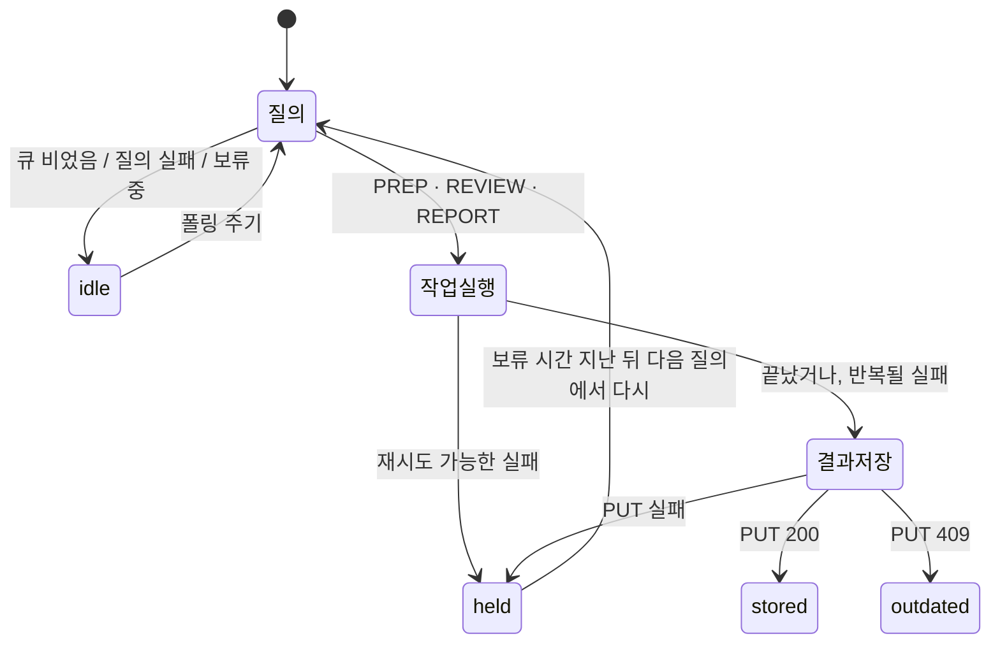
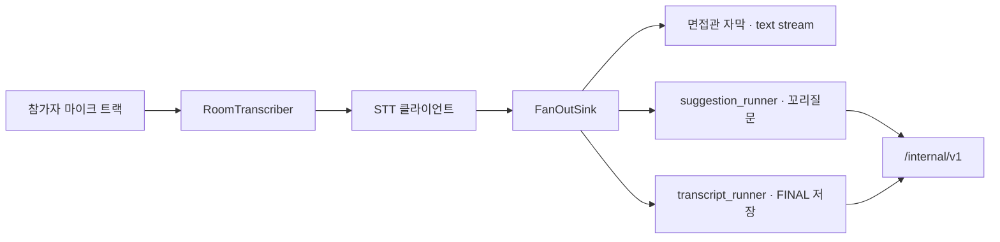

# 에이전트 파이프라인

기준 2026-11-10 · `develop` `c78c543`. 아래 수치와 전이는 모두 그 시점 저장소 코드에서 읽은 것이고, 항목마다 파일과 줄을 적었습니다. 운영 환경변수로 달라지는 값은 「운영」으로 따로 적었습니다.

이 문서는 `ai/src/irya_ai/prep_poller.py`와 `worker.py`의 모듈 docstring에 이미 적혀 있던 내용을 저장소 문서로 옮긴 것입니다. 둘이 어긋나면 코드가 기준입니다.

## 루프가 두 개입니다

| 루프 | 프로세스 | 무엇이 다음 단계를 당기는지 | 사람이 개입하는 곳 |
| --- | --- | --- | --- |
| 분석 폴러 | `ai-poller` (`prep_poller.py`) | Backend의 작업 큐. 이 프로세스가 스스로 묻고, 받아서, 돌리고, 되돌려 놓습니다 | 없음. 면접 생성·이력서 업로드·면접 종료가 큐에 행을 만들면 그걸로 끝입니다 |
| 실시간 루프 | `ai` (`worker.py`) | LiveKit의 방 디스패치와 마이크 오디오 | 없음. 방이 생기면 워커가 붙고, 발화가 떨어지면 자막·전사·꼬리질문이 알아서 갈라집니다 |

둘 다 단계마다 사람이 눌러 주는 구조가 아닙니다. 폴러 쪽은 상태(어떤 작업을 지금 건드리지 않을지)를 프로세스가 직접 들고 있고, 워커 쪽은 상태를 들지 않는 대신 한 발화를 세 소비자에게 흘려보냅니다.

## 분석 폴러

### Backend 쪽 전제 세 가지

`prep_poller.py:12-50`에 근거가 적혀 있습니다. 이 세 가지가 루프 모양을 결정합니다.

1. **물어본다고 가져가는 게 아닙니다.** `GET /jobs/pending`은 결과가 저장되거나 Backend 자신의 제한 시간이 지나기 전까지 **같은 작업을 계속 다시 내줍니다**. 그래서 한 번에 한 건만 처리하고, 못 끝낸 작업은 폴링 주기로 다시 집어오지 않도록 이쪽에서 보류를 겁니다.
2. **결과는 자기가 답하는 요청을 지목합니다.** 작업의 `requestedAt`을 `PUT` 본문에 그대로 돌려주고, `409`가 오면 도는 동안 요청이 교체된 것이라 그 결과를 **버립니다** (`:819-831`).
3. **`failed`를 저장하면 그건 결과입니다.** Backend는 FAILED로 기록하고 작업을 큐에서 뺍니다. 그래서 다음에 다르게 끝날 수 있는 실패(모델 타임아웃, 게이트웨이 혼잡)는 저장하지 않고 보류하고, 다시 해도 같을 실패(역량 없음, 깨진 컨텍스트, 모르는 세션)는 저장합니다.

여기에 하나 더: **가장 오래된 작업만 내줍니다** (`:46-50`). 큐에 남은 작업 하나가 뒤의 모든 작업을 막습니다(head-of-line). 반복될 실패를 보류가 아니라 저장으로 보내는 두 번째 이유이고, 아래에서 보류 시간이 두 종류로 갈리는 이유입니다.

### 패스 한 번은 네 가지로 끝납니다

`Outcome = Literal["idle", "stored", "outdated", "held"]` (`:125`). `run_once()`는 자기 예외를 올리지 않습니다 (`:462-508`).

| 결과 | 무슨 뜻인지 | 걸리는 조건 | 근거 |
| --- | --- | --- | --- |
| `idle` | 할 일이 없었음 | 큐가 비었거나, 묻는 것 자체가 실패했거나(로그만 남김), 받은 작업이 아직 보류 중 | `:471-479` |
| `stored` | 결과를 Backend에 넣었음 | `PUT` 성공. 보류 기록도 지웁니다 | `:854-856` |
| `outdated` | 결과를 버렸음 | `PUT`이 `BACKEND_CONFLICT`. 요청이 교체됐으니 큐에 있는 새 요청이 답을 맡습니다 | `:821-831` |
| `held` | 이 작업을 잠시(또는 오래) 건드리지 않음 | 아래 표 | `:490`, `:508`, `:529`, `:601`, `:633`, `:697`, `:799`, `:833`, `:846` |

### 보류가 걸리는 자리

| 자리 | 보류 길이 | 왜 | 근거 |
| --- | --- | --- | --- |
| 에이전트 밖에서 예상 못 한 예외 | `retry_after_seconds` | 보류가 없으면 다음 질의가 폴링 주기로 같은 작업을 다시 내줍니다. 로그에는 예외 **타입만** 남깁니다 — 메시지에 전사 내용이 들어올 수 있어서 | `:487-495` |
| 재시도 가능한 분석 실패 | `retry_after_seconds` | 지나갈 수 있는 순간 하나로 면접을 영구 실패시키지 않기 위해. Backend의 제한 시간이 그 반복의 상한입니다 | `:525-537` |
| 리뷰 세 에이전트 중 하나가 재시도 가능하게 실패 | `retry_after_seconds` (단, 마감 안에 들어갈 때만) | 지금 저장하면 성공한 둘은 남고 실패한 하나를 영구히 잃습니다. 그런데 Backend 제한은 요청 시각부터 세므로 그게 지나면 성공한 둘까지 잃습니다. 그래서 **다음 시도가 마감 안에 끝날 수 있을 때만** 보류 (#234) | `:601`, `:633`, `:697` |
| `PUT`이 재시도 가능하게 실패 | `retry_after_seconds` | 결과는 멀쩡한데 저장이 안 된 것 | `:832-841` |
| `PUT`을 Backend가 거부 (재시도 불가) | `give_up_seconds` | 이쪽이 뭘 해도 이 작업이 큐에서 안 나갑니다. 뒤가 다 밀리므로 로그 수준은 `error` | `:843-852` |
| 처리할 수 없는 작업 종류 | `give_up_seconds` | 저장할 결과 자체가 없습니다. 같은 이유로 `error` | `:500-509` |

보류는 `holds` 딕셔너리에 `작업키 → 해제 시각`으로 들고 있고 (`:885-898`), 256개가 넘으면 만료된 것부터 정리합니다 (`HOLD_PRUNE_SIZE`, `:123`). 결과가 저장되거나 `409`로 버려지면 그 작업의 보류 기록은 지웁니다.

### 시간 상수

| 상수 | 저장소 기본값 | 역할 | 근거 |
| --- | --- | --- | --- |
| `POLL_INTERVAL_SECONDS` | 5초 | 할 일이 없을 때 다시 묻는 간격 | `:108` |
| `RETRY_AFTER_SECONDS` | 30초 | 다시 해 볼 만한 실패의 보류 | `:109` |
| `GIVE_UP_SECONDS` | 600초 | 이쪽에서 손쓸 수 없는 작업의 보류 | `:115` |
| `REVIEW_DEADLINE_SECONDS` | 180초 | 리뷰 재시도를 포기하는 선. Backend의 `summary_timeout_seconds`와 같은 값을 받습니다 | `:120` |

**`REVIEW_DEADLINE_SECONDS`는 세 군데가 갈려 있습니다.** 코드 기본값 180초(`prep_poller.py:120`, `ai/src/irya_ai/config.py:72`), `ai/.env.example` 180초, 그런데 운영은 compose의 `${SUMMARY_TIMEOUT_SECONDS:-600}`이 들어가 **600초**입니다(2026-10-31 운영 확인). `prep_poller.py:15-16` docstring은 아직 "three minutes"로 적혀 있습니다. 어느 쪽으로 맞출지는 아직 안 정했고, `docs/architecture/README.md`의 「남겨 둔 것」에도 같은 항목으로 남아 있습니다.

### 타임아웃·재시도·에러 코드

| 자리 | 정책 | 근거 |
| --- | --- | --- |
| findings 에이전트 한 번의 호출 | `asyncio.timeout(timeout_seconds)`, 기본 60초. 넘으면 `LLM_TIMEOUT`을 재시도 가능으로 | `findings.py:201`, `:239`, `:242` |
| LLM 호출 에러 분류 | `LLM_TIMEOUT` · `LLM_RATE_LIMITED` · `LLM_UNAVAILABLE`은 재시도 가능, `LLM_API_ERROR`는 `status_code >= 500`일 때만 | `openai_summary.py:110-117` |
| Backend 호출 | 지수 백오프 `backoff_seconds * 2 ** attempt` (기본 0.5초)로 `retries`회까지. 재시도 불가 에러는 즉시 포기 | `backend.py:92`, `:269-271` |
| Backend 에러 분류 | `BACKEND_REQUEST_FAILED`만 재시도 가능. `AUTH_FAILED` · `CONFLICT` · `MALFORMED_RESPONSE` · `CLIENT_CLOSED` · `CLIENT_ERROR`는 불가 | `backend.py:141-304` |
| STT 배포 장애 | 연속 실패 3회에 서킷 오픈, 5초 쿨다운 뒤 단일 프로브로 반개방 | `stt/circuit.py:34-35`, `:49-57` |
| 꼬리질문 한 라운드 | 10초. `LLM_TIMEOUT_SECONDS`보다 **일부러 짧게** 잡았습니다 — 면접관이 넘어간 뒤 오는 질문은 값이 없고, 테크스펙 N3이 그 순간으로부터 3초를 요구합니다. 같은 발화로 재시도하지 않습니다 | `worker.py:60-65`, `:124` |
| 꼬리질문 러너 종료 | 5초 안에 못 끝나면 그냥 접습니다 | `suggestion_runner.py:46`, `:116` |
| LLM 게이트웨이가 없을 때 | 추출형(extractive) 기준선으로 돕니다. 멈추지 않습니다 | `prep_poller.py:926`의 `build_agents`, `cli.py:563`의 `--backend extractive` |

컨텍스트 세션 불일치는 재시도 불가로 끊습니다 (`CONTEXT_SESSION_MISMATCH`, `:866-869`, `:878-882`) — Backend가 다른 세션을 답했을 때 그 결과를 저장하면 엉뚱한 면접에 다른 사람 이력서가 붙기 때문입니다.

### 작업 종류

`JOB_KIND_PREP` · `JOB_KIND_REVIEW` · `JOB_KIND_REPORT` 세 가지를 한 프로세스가 받습니다 (`:86-88`, `:480-484`). PREP는 면접 생성·이력서 재업로드에서, REVIEW는 면접 종료에서, REPORT는 리포트 요청에서 행이 생깁니다. REVIEW는 요약·타임라인·findings 세 에이전트를 **동시에** 돌려 결과 하나로 묶어 `.../review`에 넣습니다.

로그에는 이력서 본문이나 지원자 이름을 넣지 않습니다. Backend의 id와 결과 종류만으로 작업을 다시 찾습니다 (`:55-57`).

## 실시간 루프

`worker.py:1-22`. 방 하나가 작업 하나입니다. 워커는 이름 없이 떠 있고, 지금의 단일 제품 LiveKit 배포가 새 방에 자동 디스패치합니다.

- 발화 하나가 `FanOutSink` 하나를 지나 세 갈래로 갑니다. **자막은 뒤쪽 둘을 기다리지 않습니다.**
- `transcript_runner`는 FINAL 발화만 보내는 유계(bounded) 송신기입니다. 밀리면 자막이 아니라 송신 쪽이 막힙니다.
- `suggestion_runner`는 꼬리질문 루프를 돌고, 채택된 것만 `/internal/v1`로 올립니다.
- `STT_PROVIDER=deepgram`이면 Elice 클라이언트 자리에 마이크당 Deepgram WebSocket 하나가 들어갑니다. 스트림 이후는 같습니다. 저장소 기본값은 `elice`, **운영은 `deepgram`** (2026-10-24부터, `docs/architecture/README.md`).

## 분석 단계를 툴 콜링으로 하지 않은 이유

이력서 파싱 → 역량 추출 → 질문 생성, 전사 → 요약 · 타임라인 · findings는 모두 **코드가 정한 고정 순서**입니다. 모델에게 도구 목록을 주고 다음 단계를 고르게 하지 않았습니다. 의도한 선택이고 이유는 이렇습니다.

- **도메인이 면접 전사입니다.** 모델이 다음에 어떤 도구를 부를지 고르게 하면, 고르는 근거도 전사에서 나옵니다. 사람에 대한 판단이 들어가는 출력에서 그 분기가 틀리면 틀린 이유를 추적할 수가 없습니다. 지금은 어느 단계에서 무엇이 빠졌는지 실행 기록만 보고 말할 수 있습니다 (`ai/docs/prep-eval.md`, `timeline-eval.md`).
- **제한 시간이 요청 시각부터 셉니다.** 단계 수가 모델 판단에 따라 달라지면 한 작업의 벽시계 시간을 미리 가둘 수 없습니다. 위의 리뷰 마감 계산(`review_deadline_seconds`)은 단계 수가 고정이라는 전제 위에 서 있습니다.
- **게이트웨이 제약이 있습니다.** Elice 게이트웨이의 비스트리밍 `max_completion_tokens` 상한이 2,000입니다 (`openai_summary.py:50-52`). 왕복 횟수가 늘어나는 쪽보다 한 번에 정해진 모양을 받는 쪽이 이 상한 안에서 다루기 쉽습니다.
- **대신 다른 데에 썼습니다.** 자율성은 "모델이 도구를 고르는 것"이 아니라 "사람이 단계마다 트리거하지 않는 것"으로 두고, 그 자율성을 위의 폴러 상태 기계와 실패 분류에 넣었습니다.

바꿀 만한 자리는 findings 쪽입니다. 근거 인용을 전사에서 직접 집어 오는 단계는 도구 호출로 두면 인용 위조를 줄일 수 있습니다. 지금은 인용 수를 세서 사람이 확인합니다.

## 남겨 둔 것

- `REVIEW_DEADLINE_SECONDS` 180초 / 운영 600초 / docstring "3분" 세 군데를 한쪽으로 맞춰야 합니다.
- 멘토가 주간 PR(#178)에서 요청한 **작업 한 건의 벽시계 시간 측정**은 매 작업 로그에 에이전트 시간과 전체 시간으로 남고 있지만(`:55-57`), 모아서 본 적은 없습니다. "물어본다고 가져가는 게 아니다"라는 전제가 성립하려면 한 작업이 제한 시간 안쪽에서 충분히 여유 있게 끝나야 합니다.
- 꼬리질문 러너의 종료 타임아웃 5초는 근거를 재 본 값이 아닙니다.
