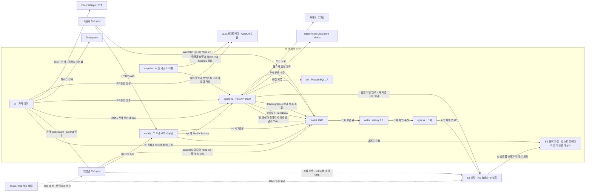

# 시스템 구조

기준 2026-10-31 · `develop` `71510e5`. 아래는 그 시점 저장소 파일에서 읽은 것이 기준입니다. 운영 `.env` 와 컨테이너 환경변수는 2026-10-31 에 운영 서버에서 직접 확인한 항목만 「운영」으로 적었고, 실값은 공개 저장소라 적지 않았습니다.

## 전체 그림

FE 는 컨테이너가 아닙니다. CD 가 빌드를 S3 에 올리고, 배포가 그 빌드를 서버 디렉터리에 내려놓고, Caddy 가 그것을 읽기 전용으로 마운트해 그대로 내보냅니다.

WebRTC 미디어는 Caddy 를 거치지 않습니다. 브라우저가 인스턴스에 직접 붙습니다. Caddy 를 지나는 것은 `/rtc*` 시그널링뿐입니다.

## 컨테이너

`infra/docker-compose.yml` 기준 여덟 개입니다.

| 서비스 | 컨테이너 | 역할 | 노출 포트 | 주요 의존 |
| --- | --- | --- | --- | --- |
| caddy | irya-caddy | TLS 종료, 경로 라우팅, FE 정적 파일 서빙 | 80, 443/tcp, 443/udp | 없음 |
| backend | irya-backend | API, 세션, 내부 API(`/internal/v1`), 녹화 합치기 | 없음 (`8000` 은 compose 네트워크 안에서만) | db (healthy) |
| ai | irya-ai | LiveKit 워커. 방마다 작업 프로세스를 띄워 마이크를 전사 | 없음 (`8081` 헬스체크는 컨테이너 안) | livekit |
| ai-poller | irya-ai-poller | 사전 가공(PREP)과 면접 후 리뷰(REVIEW) 폴러. LiveKit 에 붙지 않음 | 없음 (HTTP 포트 없음, 헬스체크 비활성) | backend (healthy) |
| db | irya-db | PostgreSQL 17 | 없음 (`5432` 는 네트워크 안에서만) | 없음 |
| livekit | irya-livekit | 시그널링 + RoomService. 미디어는 직접 수신 | 7881/tcp, 7882/udp (`7880` 은 비공개) | redis |
| redis | irya-redis | Valkey 8.1. LiveKit과 egress 가 녹화 작업을 주고받는 큐, 방 상태, 녹화 목록 | 없음 | 없음 |
| egress | irya-egress | TrackEgress 녹화. 재인코딩 없이 S3 `rec/` 로 업로드 | 없음 | redis, livekit |

밖에서 닿는 포트는 보안 그룹 기준 80 · 443/tcp · 7881/tcp · 7882/udp 입니다. compose 는 443/udp(HTTP/3)도 열지만 보안 그룹에 없습니다.

`backend` 는 redis 를 쓰지 않습니다. 녹화 목록은 LiveKit API(`list_egress`)로 읽습니다.

`/internal/v1` 과 `/twirp` 는 Caddyfile 이 열지 않습니다. 밖에서 부르면 401 이 아니라 FE 페이지가 돌아옵니다. 같은 compose 네트워크 안에서만 닿습니다.

## 외부 의존

| 대상 | 무엇에 쓰는지 | 상태 |
| --- | --- | --- |
| LiveKit | 시그널링, 미디어, RoomService, 웹훅. 같은 인스턴스에서 자체 호스팅 | 켜짐. 키 없으면 기동 실패 |
| S3 버킷 | 버킷 하나를 접두사로 나눠 씁니다. `rec/` 는 egress 트랙 파일과 BE 가 합친 파일, `fe/<sha>/` 는 CD 가 올리고 배포가 받아 가는 FE 빌드 | 녹화는 `RECORDING_BUCKET` 이 스위치이고 비우면 녹화를 걸지 않음. FE 쪽은 켜짐 |
| CloudFront 녹화 배포 | 녹화 재생 URL 서명. 우리 키로 서명해 3시간 | `RECORDING_CDN_DOMAIN` 이 스위치. **운영은 꺼져 있습니다** — 2026-10-31 운영 `backend` 컨테이너의 `RECORDING_CDN_DOMAIN` 이 비어 있는 것을 확인했습니다. 운영 녹화 재생은 10분 S3 서명 URL 입니다 |
| LLM 게이트웨이 (Elice, OpenAI 호환) | 꼬리질문(ai), 사전 가공·요약·타임라인·findings(ai-poller) | `LLM_BASE_URL` 과 `LLM_API_KEY` 가 스위치. 비우면 추출형으로 돎. **운영은 켜져 있습니다** |
| Deepgram | 실시간 STT. `nova-3`, 한국어, numerals 끔, endpointing 300ms, 고정 keyterm, Silero VAD 0.7초 침묵 후 finalize | `STT_PROVIDER=deepgram` 일 때만. 키 없으면 워커가 방을 떠남 |
| Elice Whisper STT | 실시간 STT. 저장소 기본 공급자 | `STT_PROVIDER` 기본값이 `elice`. 배포 주소나 키 없으면 워커가 방을 떠남 |
| Elice Helpy Document Vision | BE 의 문서 본문 추출 | `APP_ENV=production` 이면 값이 없을 때 기동 거부 (`backend/app/services/documents.py:151`) |
| 카카오 로그인 | BE 토큰 교환. Redirect URI 는 FE 콜백 | **운영에서 켜져 있고 로그인이 됩니다**(PM 확인). compose 가 `:-` 로 넘겨 비어 있어도 기동은 되므로 저장소만으로는 알 수 없는 자리입니다 |

## 저장소 기본값과 운영 설정이 다른 것

| 항목 | 저장소 기본값 | 운영 | 근거 |
| --- | --- | --- | --- |
| `STT_PROVIDER` | `elice` | `deepgram` (2026-10-24부터). 운영 자막은 Deepgram | 기본값은 `ai/src/irya_ai/config.py:38`, compose `${STT_PROVIDER:-elice}`, `infra/.env.example`. 분기는 `ai/src/irya_ai/worker.py:213`. 운영 값은 2026-10-31 운영 `.env` 에서 `deepgram` 으로 확인 |
| `RECORDING_CDN_DOMAIN` | 비어 있음 → S3 10분 서명 URL | 비어 있음 → **꺼짐**. 운영 녹화 재생은 10분 S3 서명 URL (2026-10-31 운영 컨테이너 환경변수 확인) | compose `${RECORDING_CDN_DOMAIN:-}`. `recording.py` 의 `_cdn_signer` 는 도메인이 비면 `None` 을 돌려주고, `presign` 이 `URL_TTL` 10분으로 떨어짐. 켜져 있으면 `CDN_URL_TTL` 3시간. 운영 값은 서버에만 있어 읽지 않았습니다 |
| `SUMMARY_TIMEOUT_SECONDS` | 코드 기본 180초 (`backend/app/core/config.py:78`, `ai/src/irya_ai/config.py:72`) | **600초** | 운영 `.env` 에 키는 있고 값이 비어 있어서, compose 의 `${SUMMARY_TIMEOUT_SECONDS:-600}` 이 600 을 넣습니다(2026-10-31 확인). 같은 값이 BE 와 폴러의 `REVIEW_DEADLINE_SECONDS` 로도 갑니다. `ai/.env.example` 은 180, `prep_poller.py` 문서는 아직 "3분"으로 적혀 있어 세 군데가 갈립니다 |
| `OPENAI_API_KEY` | `infra/.env.example` 에 「요약 LLM」으로 있음 | compose 가 어느 서비스에도 넘기지 않음. 요약·타임라인·findings 는 ai-poller 가 `LLM_*` 로 돎 | compose 에 `OPENAI` 문자열 없음 |

## 남겨 둔 것

- 운영 `.env` 에 `RECORDING_CDN_DOMAIN` 은 비어 있는데 `RECORDING_CDN_KEY_ID` 에는 값이 남아 있습니다. 도메인이 비면 서명을 걸지 않으니 동작에는 영향이 없고, 10/11 시험 자원을 지울 때 남은 설정으로 보입니다. 정리 대상입니다.
- `SUMMARY_TIMEOUT_SECONDS` 가 코드 180초 · 운영 600초 · `prep_poller.py` 문서 "3분" 으로 갈려 있습니다. 한쪽으로 맞춰야 합니다.
